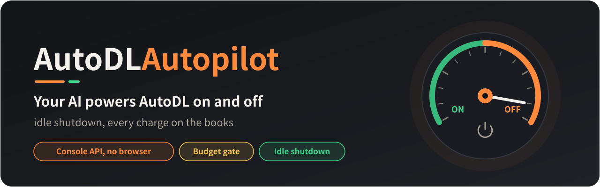
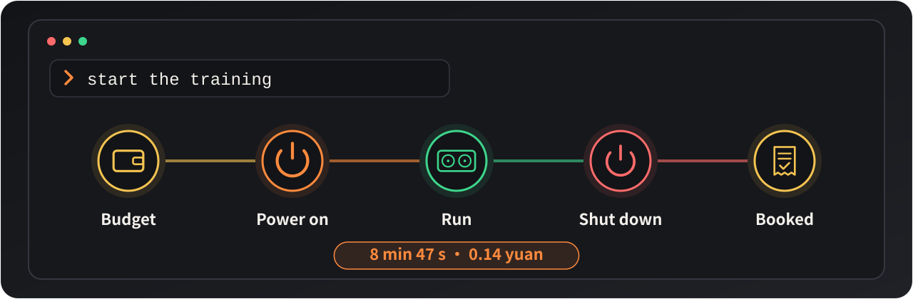
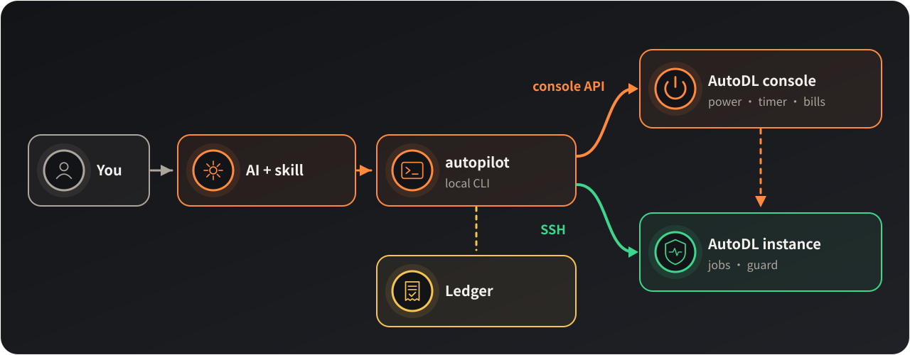

<p align="center"></p>

<p align="center">
<b>Let an AI power your AutoDL instances on and off.</b> Say "start the training": it checks the budget, powers on, runs the job, then shuts down and books the cost.
</p>

<p align="center">
<a href="#start">Quick start</a> ·
<a href="#how">How it works</a> ·
<a href="#safety">Cost and safety</a> ·
<a href="#faq">FAQ</a> ·
<a href="README.md">中文</a>
</p>

> **Unofficial project.** Not affiliated with, authorized by or endorsed by AutoDL or its operator; it calls the API the console's web page uses itself. Costs and risks of powering instances on and off are the user's own. See the [Disclaimer](#disclaimer) and [DISCLAIMER.md](docs/DISCLAIMER.md).

<p align="center"></p>

- **No idle billing**: the instance shuts down when the job ends or it sits idle, even if the conversation is gone.
- **No browser**: power, the shutdown timer and the bills all go through the console API, in seconds.
- **Know what you spend**: every power-on passes a budget gate, and the ledger comes from the console's own bills.
- **Move data without powering on**: upload, download and delete on the file storage (文件存储) go through the console while the instance is off, paying neither GPU nor no-GPU hours.
- **Find and rent a machine**: searches the GPU market by model, region, free GPUs, price and CUDA version (about a second); when your host has no free GPU it lists other machines with the same model; then rents the one you chose, never without your yes.

<a id="start"></a>

## Quick start

**1. Install** (for Claude Code. A version for Codex will follow. Needs Python 3.8+ and OpenSSH.)

```bash
git clone https://github.com/ButterFuture/AutoDL-Autopilot ~/.claude/skills/autodl-autopilot
```

**2. Store the console token**

In the logged-in AutoDL console press F12 and run `copy(localStorage.token)`; then run this in your own terminal, paste and press Enter. The token never enters the conversation.

```bash
~/.claude/skills/autodl-autopilot/bin/autopilot token set
```

**3. Tell the AI to use it**

```
This project's experiments run on AutoDL. Use autodl-autopilot to power the instance on and off.
```

The AI makes a dedicated SSH key and puts its public half on the instance at the first connection, with nothing for you to paste; then it asks for the instance ID, how to use GPU and non-GPU mode, the budget and the idle time; the settings go into the project's `CLAUDE.md`. After that just say what you need, or call it with `/autodl-autopilot`.

| You say | It does |
|---|---|
| start the training | checks the budget, powers on with GPU, starts the guard and the job |
| upload the data, then shut down | powers on without GPU (0.1 yuan an hour), uploads, shuts down, books |
| how much budget is left this month | reads the local ledger, no power-on |
| any free 4090 in 内蒙 under 2 yuan? | searches the GPU market, lists machines with free GPUs by price |
| upload the data folder to the 内蒙 file storage | uploads it with the instance off; instances see it under `/root/autodl-fs` |
| rent the first one, two GPUs | shows a plan first (machine, price, image, planned cost); rents only after you agree, then sets up the guard as usual |

<a id="how"></a>

## How it works

<p align="center"></p>

- **autopilot** is the local command-line tool. Every step the AI takes goes through it, and a power-on passes the budget gate first.
- **The console API** powers on and off, sets the shutdown timer and reads the balance and the bills; the SSH address comes from it too, so there is no host alias to configure.
- **SSH** runs jobs, moves files and shuts the instance down normally. Every command first checks the host name and does nothing on any other machine.
- **The guard** runs from the instance's data disk and judges idleness by real GPU, CPU and network use, whether or not the conversation is still there.

<a id="safety"></a>

## Cost and safety

<p align="center"></p>

- **A fallback before every power-on**: a console shutdown timer 30 minutes ahead, cancelled only once the guard runs. Even if the conversation dies right after the power-on, the platform shuts the instance down.
- **The public key installs itself**: when the instance refuses the key, autopilot logs in once with the root password the console shows and appends the key to `/root/.ssh/authorized_keys`; from then on it uses the key. The password is never shown, stored or put on a command line. You can turn this off and use the console's 设置SSH免密登录 instead.
- **You alone store the token**, in `~/.config/autodl-autopilot/credentials` (mode 0600). It works with the screen locked, asleep or over SSH; the AI never reads or shows it.
- **Power and renting only**: power on, power off, the shutdown timer, the balance and the bills, searching the GPU market, renting pay-as-you-go. Release, reset, cloning, recharging and renewal are not in the code. Before renting you always see the plan, and nothing is ordered until you agree.
- **The console API is not an official public API** but the one AutoDL's web page uses itself; a platform change can break it, and the commands then fail with a clear error.
- Tell the AI in advance about jobs with long quiet stretches (waiting for data, sleeping): it holds the instance first, so they are not taken for idle.

<a id="faq"></a>

## FAQ

<details>
<summary><b>What if no GPU is free?</b></summary>

GPUs are not reserved while an instance is off, so a GPU power-on can find its host full. The AI tells you and retries every few minutes; for moving data or editing code, no-GPU mode works meanwhile.
</details>

<details>
<summary><b>What stays on the instance?</b></summary>

`/root/autodl-tmp/.autopilot/` on the data disk: the guard script, job logs and state; on the system disk, only one line with the public key in `/root/.ssh/authorized_keys`. Autopilot starts the guard after each power-on; an instance you power on by hand in the console has no guard.
</details>

<details>
<summary><b>How do I keep one process from being shut down while it is idle?</b></summary>

Ask the AI to whitelist it for a while, for example "keep Jupyter for 7 days". While that process lives and the entry has not expired, the instance is not shut down for idleness; afterwards the entry lapses by itself. Processes that are not whitelisted follow the default logic: only real GPU, CPU and network use counts, a process that merely exists does not.
</details>

<details>
<summary><b>Can the guard be off by default and on for one machine only?</b></summary>

Yes. Ask the AI to set the guard's default to off, then turn it on for the machine that needs it; it also works the other way round. A machine without the guard does not shut itself down: you or the AI power it off.
</details>

<details>
<summary><b>What if the instance is not used for a long time?</b></summary>

By the platform's rules an instance that stays shut down for 15 days is released and its data deleted. The AI reminds you when fewer than 3 days are left.
</details>

<a id="disclaimer"></a>

## Disclaimer

1. **Unofficial**: not affiliated with, authorized by or endorsed by AutoDL or its operator.
2. **Non-public API**: it calls the API the console's web page uses itself, not an official public API; users must follow AutoDL's terms of service and applicable laws.
3. **At your own risk**: power-on, power-off, jobs and budget checks are carried out by an AI; costs or data lost to an unwanted power-on, a missed shutdown, an interrupted job, a released instance and the like are the user's.
4. **Token safety**: the console token is equivalent to the account's login; the consequences of a leak are the user's.
5. **As is**: no warranty of any kind; the API may stop working when the platform changes, and the author has no duty to maintain it.

### Rights / takedown

If you believe this project infringes your rights or poses a risk, contact the author (including for takedown):

- Email: `ButterFuture@proton.me`
- Subject: `[AutoDL-Autopilot] Takedown / Rights Notice`
- Include: identity & contact, paths/commits, rights basis, requested action.

## License

Copyright (C) 2026 ButterFuture. Released under the [GNU AGPL-3.0](LICENSE): you may use, change and share it freely, but a changed version, including one offered as a network service, must be published under the same license with its source.
