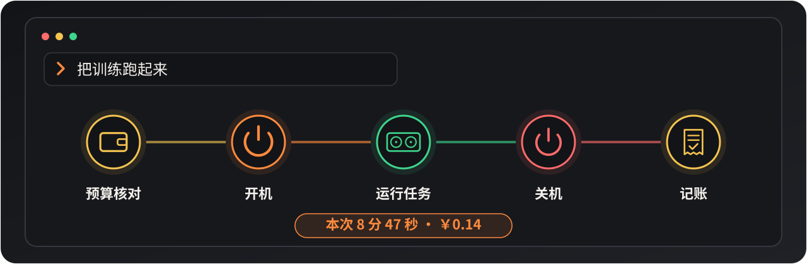
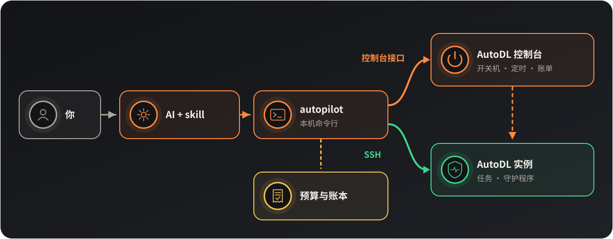

<p align="center"></p>

<p align="center">
一个给 Claude Code 用的 skill：让 AI 替你开关 AutoDL 实例、跑任务、管预算。
</p>

<p align="center">
<a href="#start">快速开始</a> ·
<a href="#how">工作方式</a> ·
<a href="#safety">费用与安全</a> ·
<a href="#faq">常见问题</a> ·
<a href="README.en.md">English</a>
</p>

> 非官方项目，与 AutoDL 平台及其运营方没有隶属、授权或合作关系。它调用的是控制台网页自己用的接口，开关机产生的费用和风险由使用者承担。详见 [免责声明](#disclaimer) 和 [DISCLAIMER.md](docs/DISCLAIMER.md)。

<p align="center"></p>

比如你说"把训练跑起来"，AI 会先看这个月的预算还够不够，再开机、启动任务，跑完关机，把这次花了多少记下来。任务结束或者机器闲着没事干，实例会自己关掉：有卡模式闲 15 分钟，无卡模式闲 60 分钟（无卡多半是在下载，给它多留点时间）。就算对话中途断了，这一步也照样会发生。

开关机、定时关机、查余额和账单都直接走控制台接口，不用开浏览器，几秒就好。另外它还能：

- 查算力市场，按型号、地区、空闲卡数、价格和 CUDA 版本筛机器，一般一秒左右出结果；选好以后可以直接租，下单前一定先问你。
- 在实例关机的状态下，往文件存储（`/root/autodl-fs`）上传、下载、删除文件，传数据不用为开机付钱。实例只在开机那一刻挂载文件存储，所以每次开机或租机前它会先看一眼这个地区的文件存储有没有初始化，没有的话先问你要不要初始化，免得开到一半再关机重开。
- 给数据盘扩容或缩容，先报价，并说清楚什么时候生效。

<a id="start"></a>

## 快速开始

需要 Python 3.8 以上和 OpenSSH。目前只支持 Claude Code，Codex 版本之后再出。

1. 安装：

```bash
git clone https://github.com/ButterFuture/AutoDL-Autopilot ~/.claude/skills/autodl-autopilot
```

2. 保存控制台令牌。在已登录的 AutoDL 控制台按 F12，在控制台里运行 `copy(localStorage.token)`；然后在你自己的终端运行下面这条命令，粘贴，回车。令牌不会经过对话。

```bash
~/.claude/skills/autodl-autopilot/bin/autopilot token set
```

3. 在项目里告诉 AI：

```
这个项目的实验在 AutoDL 上跑，用 autodl-autopilot 管开关机
```

第一次用的时候，AI 会生成一把专用的 SSH 密钥，第一次连上实例时自己把公钥装进去，你不用去控制台粘贴。然后它会问你实例 ID、有卡和无卡各用来干什么、每月预算、闲多久关机，把这些写进项目的 `CLAUDE.md`。之后直接说要干什么就行，也可以输入 `/autodl-autopilot`。

| 你说 | 它做 |
|---|---|
| 把训练跑起来 | 核对预算，有卡开机，启动守护程序和任务 |
| 把数据传上去，传完就关机 | 无卡开机（每小时 0.1 元），传完关机，记账 |
| 这个月还剩多少预算 | 读本机账本，不开机 |
| 内蒙有没有空的 4090，2 块钱以内 | 查算力市场，按价格列出有空闲卡的机器 |
| 就租第一台，两张卡 | 先给你看方案（机器、单价、镜像、预计花费），你同意了才下单 |
| 把 data 文件夹传到内蒙的文件存储 | 不开机直接上传，实例里在 `/root/autodl-fs` 下能看到 |
| 数据盘加 100G | 先报价，并告诉你什么时候生效（实例开着的话要重启） |

<a id="how"></a>

## 工作方式

<p align="center"></p>

AI 的每一步操作都通过本机的命令行工具 `autopilot` 完成。开机前它先过一遍预算。

和控制台打交道的部分（开关机、定时关机、余额、账单、算力市场、文件存储、数据盘）走控制台的 HTTP 接口。实例的 SSH 地址也是从控制台读的，所以不用自己配主机别名。

在实例上跑任务、传文件、正常关机走 SSH。每条命令执行前先核对主机名，连到的不是这台实例就什么也不做。

守护程序放在实例的数据盘上，看 GPU、CPU 和网络的实际占用来判断是不是闲着，跟对话还在不在没关系。

<a id="safety"></a>

## 费用与安全

<p align="center"></p>

每次开机前，它会先在控制台设一个 30 分钟后的定时关机，等守护程序在实例上跑起来了再取消。所以哪怕刚开机对话就断了，平台也会把实例关掉。

控制台的定时关机不管任务有没有跑完，到点就关。所以只要设了定时关机（开机时用 `--hard-limit`，或者 `autopilot timer`），AI 会在后台挂上 `autopilot remind`：关机前 30、20、10 分钟各提醒一次，并列出还在跑、会被打断的任务。AI 收到提醒后会告诉你，要么在你给的预算内延后关机，要么先让任务把结果存好。

令牌只由你自己保存，放在 `~/.config/autodl-autopilot/credentials`（权限 0600）。锁屏、息屏、SSH 会话里都能用，AI 不会读取或显示它。

SSH 公钥是自动装的：实例拒绝密钥时，它用控制台上显示的 root 密码登录一次，把公钥追加到 `/root/.ssh/authorized_keys`，之后都用密钥登录。密码不显示、不保存，也不出现在命令行里。不想这样的话可以关掉这个功能，改在控制台的"设置SSH免密登录"里自己贴公钥。

开机按你给的授权和预算来。租机器、给数据盘扩容、初始化文件存储这类新增的开销，AI 每次都先给出方案，你同意后才执行；删除文件存储里的文件也要先问你。释放、重置、克隆、充值、续费这些操作，代码里根本没有。

实例连续关机 15 天会被平台释放，数据盘上的东西也会一起删掉。每次关机后它会提醒你：要关很久的话，先把重要的结果拉回本机，或者存到文件存储里。

如果有任务会长时间几乎不占资源（比如在等数据、在 sleep），提前告诉 AI，它会先把实例保持住，免得被当成空闲关掉。

还要说明一点：控制台接口不是官方公开的 API，而是 AutoDL 网页自己在用的接口。平台改版后它可能失效，到时命令会明确报错。

<a id="faq"></a>

## 常见问题

<details>
<summary><b>没有空闲 GPU 怎么办？</b></summary>

按量计费的实例关机后不保留 GPU，再用有卡模式开机时，主机上的卡可能已经被别人占了。AI 会告诉你，然后隔几分钟重试；也可以让它在算力市场里找同型号的其他机器。只是传数据或改代码的话，可以先用无卡模式。
</details>

<details>
<summary><b>数据盘扩容要重启吗？</b></summary>

实例在运行时也能下单扩容，但要重启以后新空间才生效，在那之前实例还是原来的大小。重启就是关机再开机，会中断正在跑的任务；有卡模式下关机还会释放 GPU，再开时卡可能已经没了。所以 AI 每次都会先跟你说清楚，建议等任务跑完再重启，或者先关机再扩容。关机状态下扩容，下次开机就生效。缩容只能在关机时做，而且只支持按量计费的实例。
</details>

<details>
<summary><b>实例上会留下什么？</b></summary>

数据盘上的 `/root/autodl-tmp/.autopilot/`，里面是守护脚本、任务日志和状态；系统盘上只在 `/root/.ssh/authorized_keys` 里加了一行公钥。守护程序是 autopilot 每次开机后启动的，你自己在控制台手动开机的话就没有守护。
</details>

<details>
<summary><b>某个进程闲着也不想被关，怎么办？</b></summary>

让 AI 把它加进白名单，并给个期限，比如"Jupyter 保留 7 天"。期限内只要这个进程还在，实例就不会因为空闲被关；过了期限自动失效。没加白名单的进程按默认规则处理：只看 GPU、CPU 和网络的实际占用，进程挂着但什么都不干，不算忙。
</details>

<details>
<summary><b>能不能默认不开守护，只给某台机器开？</b></summary>

可以。让 AI 把守护的默认值改成关闭，再给需要的那台机器单独打开；反过来，也可以只对某一台关闭。没开守护的机器开机后不会自己关，要你或 AI 手动关。
</details>

<details>
<summary><b>实例长期不用会怎样？</b></summary>

按平台规则，连续关机 15 天的实例会被释放，数据全部清空。AI 看到离释放不足 3 天时会提醒你。要长期留着的东西，请提前拉回本机或者放进文件存储。
</details>

<a id="disclaimer"></a>

## 免责声明

1. 本项目是非官方的，与 AutoDL 平台及其运营方没有隶属、授权或合作关系。
2. 它调用的是控制台网页自己使用的接口，不是官方公开的 API。使用者需要自行遵守 AutoDL 的服务条款和相关法律。
3. 开关机、任务和预算判断都由 AI 自动执行。误开机、没及时关机、任务被中断、实例被释放等造成的费用或数据损失，由使用者承担。
4. 控制台令牌等同于账号登录，泄露的后果由使用者承担。
5. 软件按现状提供，不附带任何担保。平台改版后接口可能失效，作者没有持续维护的义务。

### 权利通知

如果你认为本项目侵犯了你的权利或存在风险，请联系作者处理，包括要求下架：

- 邮箱：`ButterFuture@proton.me`
- 标题建议：`[AutoDL-Autopilot] 权利通知 / Takedown`
- 请尽量写明：你的身份和联系方式、涉及的具体路径或提交、权利依据、希望怎么处理。

## 许可证

Copyright (C) 2026 ButterFuture。本项目以 [GNU AGPL-3.0](LICENSE) 发布：可以自由使用、修改和再发布，但修改后的版本（包括通过网络提供服务的版本）必须以同一协议公开源代码。
